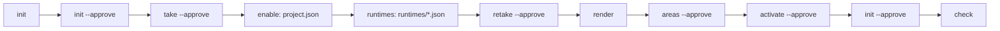
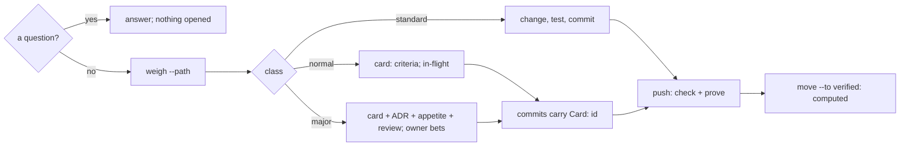

# Setting a repository up, and working in it

agent-kit needs Python 3.10+ and git, and nothing else. It works ALONE in any repository; with a build
tool beside it (stack-kit, or any tool whose adapter publishes a module map) it also weighs and proves
each change by the module it lands in. Every command below is `python <kit>/interpreters/cli.py <verb>
--root .`, where `<kit>` is `kits/agent-kit/kit` before the install and `.agents/kit` after it.

## 1. The setup pipeline

One door does it all: `start` walks a published starter. Run it with `--plan` first: it prints the
exact acts for that starter, in order, and writes nothing.

```sh
python kits/agent-kit/kit/interpreters/cli.py start --root . --path kits/agent-kit/starters/standard.json --plan
python kits/agent-kit/kit/interpreters/cli.py start --root . --path kits/agent-kit/starters/standard.json --approve "<you>"
```

The same acts, walked by hand, in the order `start` walks them -- each is safe to run again. Two of
them are not verbs but a line in a declaration, which `start` writes for you:



| # | act | what it does | what it writes | door |
|---|---|---|---|---|
| 1 | `init` | reads the repository (the detectors every taken capability brings) and drafts the host's answer | `.agents/project/project.json` as a draft | stops at the door (exit 3) |
| 2 | `init --approve <you>` | accepts the answer and installs the kit: the pinned copy, the seeds, the projections | `.agents/kit/`, `.agents/project/*`, `.agents/generated/*`, `docs/work/` | yes |
| 3 | `take --path <dirs> --approve <you>` | places capabilities the release did not issue -- adapters, bundles, policies -- beside the pinned kit, pinned by digest | `.agents/taken/<id>/`, `.agents/project/taken.json` | yes |
| 4 | *enable* (by hand: add the taken ids to `capabilities`) | turns the taken capabilities on in the host's answer | `.agents/project/project.json` | -- |
| 5 | *runtimes* (by hand: one `{"id", "class", "surface"}` file per runtime, as the starter lists them) | declares which agent runtimes the host serves (Claude Code, Codex, git) | `.agents/project/runtimes/<id>.json` | -- |
| 6 | `retake --approve <you>` | re-reads the repository: a taken adapter may bring a detector (stack-kit's reads `stack-kit.json`) | `.agents/project/profile.json` | yes |
| 7 | `render` | serves every surface from the declarations | `CLAUDE.md`, `AGENTS.md`, `.claude/`, `.codex/`, `.githooks/`, `docs/work/BOARD.md` | -- |
| 8 | `areas --approve <you>` | drafts the host's areas -- where a change lands, what undoing it costs, what proves it -- from the modules a build tool declares, plus its prose; only adds | `.agents/project/delivery/areas.json` | yes |
| 9 | `activate --surface git-commit --approve <you>` | points git at the served hooks (`core.hooksPath`) | the repository's git config | yes |
| 10 | `init --approve <you>` | re-attests the install after the walk changed it: measures, seeds what is new, renders, checks, and pins each taken capability's provenance | `.agents/project/estate.json` and what changed | yes |
| 11 | `check` | judges every declared gate; green means the install is whole | nothing | -- |

Then commit everything the walk wrote. An existing repository is adopted the same way: `init` reads
what is there; a prior agent system is mapped with `adopt` (a migration map, ADR-011).

## 2. Working in it, every day



- `weigh --path <a>,<b>` -- the class a change computes, what it owes, its doors, who it feeds; the paths
  are comma-separated. `weigh --base <rev> --head <rev>` weighs a range; `--each` holds every commit of it
  to the floor its own hook would have, and needs `--head`.
- `capture --card <id> --title "<what>" --by <you>` -- opens a card in `intake`. Add to its JSON only what
  the class requires -- for `normal` the first two fields, for `major` all four:

  ```json
  "class": "major",
  "criteria": [{"id": "green", "statement": "the suite passes", "needs": "tested",
                "proof": {"kind": "test-report-passed", "ref": "<the JUnit or TRX report>"}},
               {"id": "reviewed", "statement": "a peer approved it", "needs": "review",
                "proof": {"kind": "review-approved", "ref": "docs/work/evidence/<id>/review.json"}}],
  "origin": {"kind": "artifact-present", "ref": "docs/decisions/ADR-<n>-<slug>.md"},
  "appetite": {"amount": 2, "unit": "day"}
  ```

  Then walk it `intake -> shaped -> in-flight`, two `move` steps: `move --card <id> --to shaped --by <you>`,
  then `move --card <id> --to in-flight --by <you>` (a `major` card is bet by the owner between them:
  `move --to bet --approve`). `reshape` changes its shape later.
- The commit hooks: `pre-commit` judges every edit against the host's edit gates; `commit-msg` holds the
  class floor (a lighter declaration, a missing card, a card shaped lighter than the change are refused).
- The push hook runs `check`, then `prove`: the commands that prove the areas the push touches, never
  twice on the same bytes; everything (every MUST's command and every area's own proof) only where the
  change owes a decision. It refuses a pushed sha that is not HEAD, or a tree that is not clean: prove
  judges the working tree, so push from a clean checkout of what you push, or let CI prove it.
- **Who holds the line.** The hooks are FEEDBACK: `--no-verify` skips them, as git documents. The
  AUTHORITY is CI -- the github-actions workflow runs `check` and `prove --full` on the exact pushed
  commit, on a clean runner with no proof cache; require it in branch protection, or the hooks are all
  there is (OWASP CI/CD security: enforce controls server-side). The proof cache is a local speed-up only:
  CI never reads it (ADR-025 amendment 5).
- `check --brief` -- what fails, and the summary: what an agent reads. `check` -- the full listing.
- The agents' own walk of all this is the skill `walk-a-piece-of-work`, served by `render`.

## 3. Alone, and with stack-kit

**Alone**, every mechanism works: the doctrine and laws, the edit gates and the commit floor, the work
classes, the board, the doors, owner signing (`signer --setup`, optional). Declare what proves the host
in its delivery policy (`.agents/project/delivery/policy.json`, `"commands": {"test": "<your test
command>"}`, each an enforcer `host:<key>`) and name it in an area's `proved_by`; with none declared,
`prove` runs the test command the host's reading declares.

**With stack-kit**, the standard starter takes its adapter, which (a) reads `stack-kit.json`'s commands
into the briefing, (b) vouches for each as `stack-kit:<key>` -- a per-module test command
`commands.test-<module>` among them, (c) publishes a module map, so `areas` drafts one area per module
proved by its own tests, and the build tool's own declarations (`stack-kit.json`, `ops/`) as costly,
and (d) is the bridge of one secret-pattern list for the edit hook, the commit gate and stack-kit's scan.
Either kit may come first; after adding the other, re-read and re-draft:

```sh
python .agents/kit/interpreters/cli.py retake --root . --approve "<you>"
python .agents/kit/interpreters/cli.py areas  --root . --approve "<you>"
```

## 4. The blueprint: every place the kit draws in a host

Owned by the kit, by the host, or generated -- the column `written by` says which. Where a place is
`pending`, the kit has drawn it and not yet built what fills it.

<!-- layout:begin -- derived from kit/capabilities/governance/host-layout.json -->
| path | holds | written by | lifecycle | read it when |
| --- | --- | --- | --- | --- |
| `.agents/kit/` | pinned-release | kit-publisher | replaced-by-release | how does the kit work |
| `.agents/taken/` | pinned-release | kit-verb | replaced-by-release | which capabilities this host added to its release |
| `.agents/project/taken.json` | take-declaration | owner | living | what did this host take beside the release |
| `.agents/project/project.json` | host-declaration | owner | living | which capabilities are enabled |
| `.agents/project/profile.json` | environment-reading | kit-verb | current-only | what tooling this repository uses |
| `.agents/project/kit.lock.json` | integrity-pin | kit-verb | replaced-by-release | which kit version is installed |
| `.agents/project/roster.json` | staffing | owner | living | who handles this kind of work |
| `.agents/project/roles/` | role-definition | owner | living | define or change a role |
| `.agents/project/doctrine/` | host-law | owner | living | which laws bind this project |
| `.agents/project/doctrine/law-scopes.json` | host-law | owner | living | which directories carry laws of their own |
| `.agents/project/doctrine/laws/` | host-law | owner | living | what a module's own laws say |
| `.agents/knowledge/private/` | private-memory (pending E) | owning-role | curated | start a session as a role |
| `.agents/knowledge/shared/` | shared-knowledge (pending E) | curator | curated | coordinate with another agent |
| `.agents/generated/roles/` | projection | renderer | regenerable | load a role's full brief |
| `.agents/generated/skills/` | projection (pending C) | renderer | regenerable | which skills are available |
| `.agents/generated/INDEX.md` | projection | renderer | regenerable | where does this live |
| `.agents/generated/runtimes/` | projection | renderer | regenerable | how a runtime is wired |
| `.agents/runtime/receipts/` | run-evidence | runtime-observer | rotated | did the run actually do it |
| `.agents/runtime/telemetry/` | measurement-stream (pending C) | runtime-observer | rotated | how much did this cost |
| `.agents/runtime/ground/` | dispatch-ground | dispatcher | current-only | receive a dispatch |
| `.agents/runtime/guards/` | guard-state (pending C) | runtime-observer | current-only | a hook blocked an edit |
| `.agents/runtime/init.journal` | operation-journal | kit-verb | per-operation | init was interrupted |
| `.agents/runtime/init.lock` | exclusive-hold | kit-verb | per-operation | a kit command says the host is held |
| `docs/intent/` | intent (pending F) | owner | living | why are we building this |
| `docs/decisions/` | decision | decision-authority | permanent | why is it built this way |
| `docs/reference/` | reference | curator | living | look up a register or ledger |
| `docs/guides/` | guide (pending F) | curator | living | how do I do this |
| `docs/work/CONTINUE-HERE.md` | work-position (pending F) | dispatcher | current-only | resume work |
| `docs/work/BOARD.md` | work-queue | dispatcher | living | what is in flight |
| `docs/work/cards/` | work-card | assigned-agent | closed-then-archived | take a task |
| `docs/work/evidence/` | work-evidence | assigned-agent | closed-then-archived | prove a card is done |
| `docs/archive/` | retired-record (pending F) | archivist | archived | what was decided before and retired |
<!-- layout:end -->

Every file the kit generates, and what it is computed from: [generated-files.md](generated-files.md).

## 5. It worked when

```sh
python .agents/kit/interpreters/cli.py check --root . --brief       # 0 gate(s) failed
python .agents/kit/interpreters/cli.py weigh --root . --path <a file you will change>
git config core.hooksPath                                           # .githooks
```
